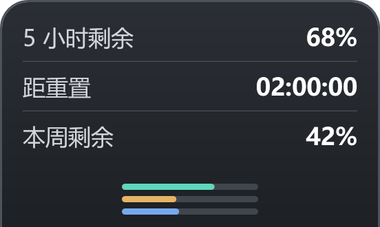

# 额度显示 · Codex Quota Edge

Windows 上随 Codex 启停的额度贴边面板。当前版本 **v2.2.2**。

显示5小时剩余额度、距重置倒计时和本周剩余额度。支持圆环、短条、长条三款样式，四边拖动吸附、位置锁定、置顶开关和设置记忆；启动与停止由后台无控制台宿主执行。

**[下载 Windows 安装包](https://github.com/fredogovo-lgtm/codex-quota-edge/releases/download/v2.2.2/CodexQuotaEdge-v2.2.2-win-x64.zip)** · [简单使用说明](docs/使用说明.txt) · [全部版本](https://github.com/fredogovo-lgtm/codex-quota-edge/releases)




以上截图使用明确的测试示例数据。

## 使用

Windows 10/11 x64；需要已安装、登录的标准商店版 Codex，系统可运行 PowerShell5.1、Windows Script Host、任务计划服务和 .NET Framework。安装包内 `source/` 是对应完整源码，普通使用无需打开。升级时同样完整解压新版并运行启用入口，保留个人配置。普通使用不需要 .NET SDK；面板已经包含 .NET8运行环境。

从仓库的 Releases 下载完整 `CodexQuotaEdge-v2.2.2-win-x64.zip`，全部解压后双击 `Enable-Follow.vbs`。首次启用后，随 Codex 桌面程序启动/退出显示/关闭；最小化时仍显示。`Disable-Follow.vbs` 停用，`Enable-Follow.vbs` 重新启用，`Start-Follow.vbs` 恢复已启用的监听。

额度读取使用本机 Codex CLI 的登录账号。默认自动识别标准 WindowsApps 安装及本机 CLI；非标准安装路径可能需要调整。尚未在另一台实体电脑实测。本构建未代码签名。

## 交互

- 青绿：5小时剩余；琥珀：重置倒计时；蓝色：本周剩余。
- 单击循环切换圆环、短条和长条。
- 悬停查看精确数据，移开收起。
- 拖动到屏幕四边，右键锁定或解除锁定。
- 左右收起26×84、展开184×84；上下收起84×26、向内展开184×110，三款样式同步转向。
- 右键“取消置顶 / 置顶显示”，开启后保持在普通应用窗口上方；下次启动记住选择，旧配置默认开启。
- 开启置顶时，切换前台软件立即检查，并约每3秒维护窗口层级；被降级、隐藏或最小化后自动恢复，不抢走键盘焦点。菜单打开、拖动、关闭过程中暂停恢复，不把其他虚拟桌面上的面板强拉回来。
- 取消置顶后，悬停、拖动或重新定位都不会强行恢复置顶。系统安全桌面、锁屏等受保护界面不在可覆盖范围。
- 重启记住位置、锁定、样式和置顶选择。拖动不切换样式。
- 重复启动已运行的面板程序可找回窗口，遵守当前置顶选择，不创建重复实例。
- 右键退出关闭本次 Codex 会话中的面板，重开 Codex 或停用再启用恢复。

额度约每60秒刷新，倒计时逐秒更新；数据缺失或过期显示灰色或“—”。设置在 `%USERPROFILE%/.codex-usage-widget/`，发行包不包含用户登录资料或个人配置。

## 源码

- `compact/`：.NET8 WPF 面板、额度客户端及 C# 测试。
- `follow/`：生命周期监听、计划任务、VBS 入口、后台宿主及 PowerShell 测试。
- `docs/images/`：测试界面截图。
- `LICENSE`、`THIRD_PARTY_NOTICES.md`、`UPSTREAM.json`：来源与许可信息。

### 构建

开发环境需要 Windows x64、.NET8 SDK、系统 .NET Framework C# 编译器及可访问 NuGet 的网络。在本仓库根目录运行 PowerShell：

```powershell
dotnet run --project compact/tests/EdgeTests.csproj
dotnet run --project compact/tests/TopmostWindowTests.csproj -- ./test-output
dotnet publish compact/CodexEdgeWidget.csproj -c Release -r win-x64 --self-contained true -p:PublishSingleFile=true -p:IncludeNativeLibrariesForSelfExtract=true -o outputs/win-x64
powershell.exe -NoProfile -ExecutionPolicy Bypass -File follow/host/Build-QuietHost.ps1 -OutputDirectory outputs/win-x64
Get-ChildItem follow -File | Where-Object { $_.Extension -in '.ps1','.psm1','.vbs','.cmd' } | Copy-Item -Destination outputs/win-x64
Copy-Item LICENSE,THIRD_PARTY_NOTICES.md,UPSTREAM.json,README-upstream.md,SECURITY.md outputs/win-x64
Copy-Item README.md outputs/win-x64/README-follow.md
```

交互测试 `compact/tests/DockWindowTests.csproj` 需要可用的交互式桌面，会操作测试窗口与鼠标位置。后台测试见 `follow/tests/`。重新构建后应重新生成发布文件哈希；`UPSTREAM.json` 和 notices 中的版本/哈希描述的是原始已发布构建，需要随新构建同步更新。

## 来源

额度读取适配自 [qeretycs-tech/codex-usage-widget](https://github.com/qeretycs-tech/codex-usage-widget) v1.8.0，MIT License，保留原作者版权与许可。新增 WPF 界面及生命周期代码按同样 MIT 条款分发。Microsoft .NET 的许可及第三方声明见 `THIRD_PARTY_NOTICES.md`。


置顶回归测试仅使用自有窗口及隔离配置。进程入口回归需 PowerShell 7：

```powershell
pwsh -NoProfile -File compact/tests/WindowRecoveryProcessTests.ps1 -ExecutablePath ./outputs/win-x64/CodexUsageWidget.exe -WorkRoot ./test-output/process
```
